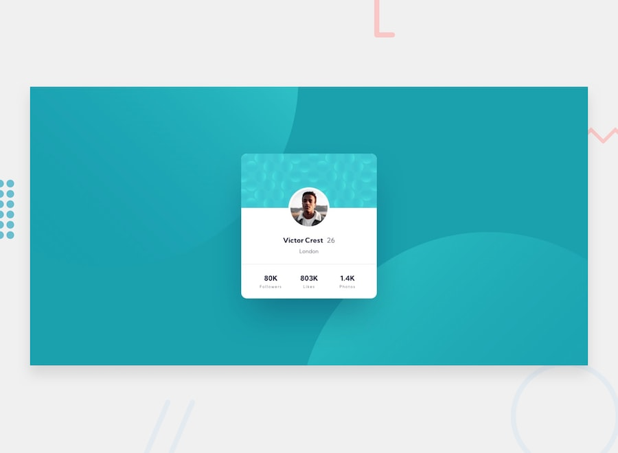
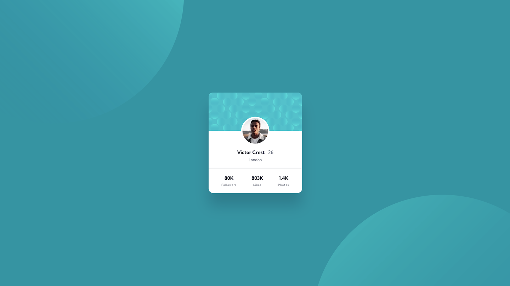

# Frontend Mentor - Profile card component solution

This is a solution to the [Profile card component challenge on Frontend Mentor](https://www.frontendmentor.io/challenges/profile-card-component-cfArpWshJ).

## Table of contents

- [Overview](#overview)
  - [The challenge](#the-challenge)
  - [Extra feature](#extra-feature)
  - [Screenshot](#screenshot)
  - [Links](#links)
- [My process](#my-process)
  - [Built with](#built-with)
  - [What I learned](#what-i-learned)
  - [AI Collaboration](#ai-collaboration)

## Overview

### The challenge

Users should be able to:

- Build out the project to the designs provided

### Extra feature

**As a** visitor of the profile card page, 
**I want to** see the stats count up from 0 to their final value, 
**so that** the card feels more lively when it appears.

### Screenshot

#### Design preview

#### My solution on desktop

### Links

- Repository URL: [GitHub Repo](https://github.com/MATBMS/profile-card)
- Live Site URL: [GitHub Page](https://matbms.github.io/profile-card/)

## My process

### Built with

- Semantic HTML5 markup
- CSS custom properties
- Flexbox
- Mobile-first workflow
- JavaScript

### What I learned

- **Flexbox axes:** `justify-content` aligns items on the main axis (horizontal in a row) and `align-items` on the cross axis (vertical in a row). To center the card on the page, I use both on the body, with a `min-height: 100vh` so there is room to center in.
- **`requestAnimationFrame` loop:** it asks the browser to call my function just before the next frame is drawn. My function calls it again by itself until the animation is finished, which makes the animation smooth.
- **Reduced motion:** some people are uncomfortable with moving content, so I check `prefers-reduced-motion` and skip the animation. The final values are then shown at once.
- **Exact final value:** at the end of the count-up, I put back the original text from the HTML. This way the result is exactly what I wrote, with no rounding surprise.

### AI Collaboration

This is a project where I act as the Product Engineer, not the developer. I define the requirements and validate every decision, and Claude Code writes the code.
